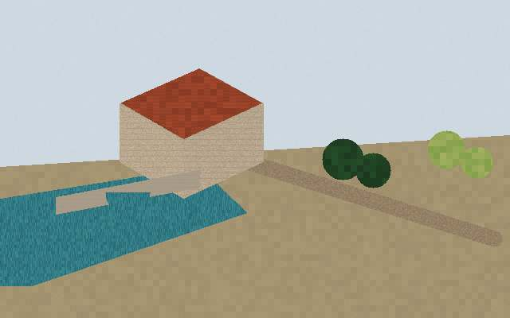
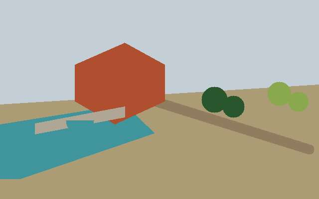

# FASE 3 — Pittura

Pittura del centro storico a finestre, sullo stesso passo di Mondo Isometrico: 1024 px, sovrapposizione 128, passo 896, sfumatura 64. Il render e il pass altezze restano quelli della FASE 2 (heading 315°, codifica a 3 cm). Le tile dipinte e la piramide AVIF stanno in `data/` e non si versionano.

## Comandi

```bash
nvm use
npm install
cp .env.example .env
npm test
npm run render
npm run paint
npm run paint -- --anteprima-stile
```

| Comando | Cosa fa |
|---|---|
| `npm run paint` | Dipinge le tile di `centro-storico` e rigenera la piramide AVIF dalle PNG dipinte |
| `npm run paint -- centro-storico --senza-piramide` | Solo le PNG in `data/derived/<area>/paint/` |
| `npm run paint -- centro-storico --only -1,-2` | Una tile, o più tile separate da `;` |
| `npm run paint -- --anteprima-stile` | Riscrive le due JPEG in `docs/` (stile mock, senza le tile del borgo) |
| `npm run export -- --dipinte` | Stessa piramide, se le PNG dipinte ci sono già |

Senza una chiave il provider è `mock`: non chiama la rete. Le 33 tile del centro non sono state ridipinte in questo passaggio, perché non stanno nel repository: il comando le legge da `data/derived/centro-storico/render/` quando ci sono.

## Stile

Il prompt e la tavolozza stanno in [config/paint.json](../config/paint.json). È un'illustrazione isometrica calda: tetti in coppi, muri in pietra calcarea, strade in terra e pietra, Aniene verde-azzurro, bosco scuro e faggeta più chiara. Non sono stati copiati i PNG di stile di Roma o di Tel Aviv.

Le anteprime qui sotto sono il provider mock su una finestra di prova (un volume, l'acqua, una strada, due chiome, un arco), non un ritaglio delle 33 tile.





Nella maschera l'edificio è un solo colore: tetto e parete li separa il pass altezze (pendenza bassa = coppi, parete = calcare). Il verde scuro è bosco, il verde chiaro è faggeta.

## Finestre e cuciture

La griglia parte dall'angolo delle tile di render e avanza di 896 px. L'ultima finestra arretra, se serve, per coprire il bordo. Ogni finestra riceve:

- il render ritagliato
- il pass altezze, ricampionato dal PNG 256×256 (16 bit spezzati in due byte, passo 3 cm, origine `heightBase − 100`)
- la maschera delle classi, proiettata con la stessa camera della FASE 2

Classi: cielo, suolo, edificio, strada, acqua, bosco, faggeta, arbusti, ponte.

Le finestre si scrivono in ordine. Dove una finestra nuova copre pixel già dipinti, i primi 64 px si fondono con una rampa smoothstep; il resto della finestra sostituisce. Due finestre con lo stesso ingresso danno lo stesso pixel, quindi la giunta del mock non si vede. Con il provider reale la striscia serve a non lasciare un taglio netto.

Poi le PNG da 1024 px in `data/derived/<area>/paint/` alimentano la stessa piramide della FASE 2 (`export` con sorgente `paint`): zoom 8 → 2, tile web 512, AVIF. `data/web/regions/subiaco/data/world.json` ha `dipinte: true`. `npm run export` senza `--dipinte` continua a leggere il render geometrico.

## Provider

In `.env`, mai nel repository:

```bash
PAINT_PROVIDER=openai
PAINT_API_KEY=
PAINT_MODEL=gpt-image-1
PAINT_API_BASE=https://api.openai.com/v1
```

`PAINT_API_KEY` vuota, o `PAINT_PROVIDER` vuoto, selezionano il mock anche se il nome chiede `openai`. Con la chiave, ogni finestra manda tre PNG all'endpoint `images/edits`: render, maschera colorata, altezze in grigio (più chiaro = più alto). Il prompt è quello di `config/paint.json` e ricorda che il passo è 3 cm, non 1 cm. Una risposta HTTP di errore non ristampa la chiave.

Il mock non è un modello: è uno shading deterministico sulla maschera e sulla pendenza del pass altezze, con una grana fissa. Serve a provare finestre, fusione e piramide senza spendere una chiamata.

## Faggeta

`classeVegetazione` in `pipeline/src/vegetazione.mjs`:

- sopra 1000 m ortometrici, `leaf_type=broadleaved` oppure WorldCover classe 10 (alberi) senza un tag di aghi → `faggeta`
- `needleleaved` e `mixed` restano bosco anche in quota
- WorldCover 20 resta arbusto
- sotto i 1000 m, anche le latifoglie restano bosco

Il centro storico è tutto sotto la soglia. La classe è pronta per Monte Livata: in scena gli alberi e i poligoni `natural=wood` / `landuse=forest` portano `classeVegetazione`, e il renderer colora la chioma di faggeta in un verde più chiaro. Livata non è stata ridisegnata.

## Ponte San Francesco

way/232122864 non è più un nastro che segue il fondovalle del DSM. In `pipeline/src/ponte.mjs` la pianta resta la spezzata OSM, le spalle sono i due estremi (le quote in mezzo, sull'acqua, non abbassano il piano) e l'intradosso è un solo arco circolare. Sotto l'arco non c'è mesh. Spessore, larghezza e freccia (al massimo 9 m) non sono misure.

La mesh entra nel GLB e nella pagina di render. Le 33 tile già scritte restano quelle del 17 novembre: per vederci l'arco serve `npm run scene` e poi `npm run render -- centro-storico --finestra rocca-ponte` (o `--force` sulle tile del ponte). Non è stato rilanciato qui.

## Segnalati, non bloccanti

- **68 edifici** del centro senza altezza misurata: restano il default di tipologia. `npm run paint` lo scrive nel log e in `paint/report.json`. Se la scena c'è, il conteggio è quello vivo (`fonteAltezza: default-tipologia`), altrimenti resta il 68 del render del 17 novembre.
- **way/1047734686** e **way/1180637482**: il volume stretto staccato dal corpo potrebbe essere un annesso e non la navata. Vanno guardati a occhio. La pittura non li modifica.

## Cosa resta

- Dipingere le 33 tile vere (`npm run paint` dove c'è già il render) e, se si vuole il modello, mettere la chiave in `.env`.
- Rifare scena e render del ponte, se l'arco deve entrare nelle tile.
- Monasteri, Monte Livata e la variante con la neve: la faggeta è solo la classe, non una pittura invernale.
- Il viewer è ancora la FASE 4.
