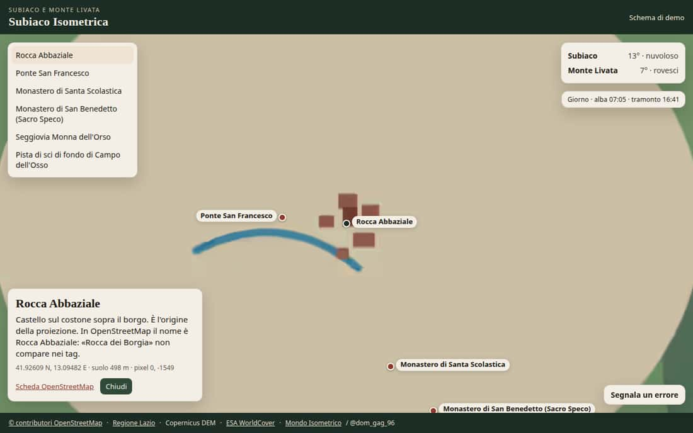

# FASE 4 — Viewer

Pagina statica in `web/`: pan, zoom, sei luoghi cliccabili, meteo Open-Meteo, giorno/notte sull'alba e il tramonto veri, segnalazione su GitHub. Non usa Astro né OpenSeadragon. I numeri della piramide restano quelli della FASE 2: tile da 512 px, zoom 8→2, overlap 0, `maxZoomPixelRatio` 2,5, `zoomPerScroll` 1,35. Il deep link è `#@x,y,zoom` in pixel d'arte.

Le tile non stanno nel repository. Se `data/web/regions/subiaco/` ha una piramide, il viewer usa quella (dipinta se `world.json` ha `dipinte: true`, altrimenti il render). Se manca, `npm run dev` scrive uno schema leggero in `data/web/regions/subiaco-demo/`: quattro tile allo zoom 2 e sedici allo zoom 3, AVIF e JPEG, circa 60 KB. Non è il borgo.



Lo scatto è del 22 novembre 2026, a mezzogiorno: Subiaco 13° e nuvoloso, Monte Livata 7° e rovesci, giorno (alba 07:05, tramonto 16:41). Lo schema non va confuso con le 33 tile del centro.

## Comandi

```bash
nvm use
npm install
npm test
npm run dev
```

| Comando | Cosa fa |
|---|---|
| `npm run dev` | Viewer su `http://127.0.0.1:4321/` |
| `npm run dev -- --porta 4400` | Un'altra porta |
| `npm run dev -- --demo` | Schema anche se la piramide c'è già |

Si trascina per spostare e si usa la rotella per lo zoom (un scatto moltiplica per 1,35, il punto sotto il cursore resta fermo). La vista si può ricopiare: l'hash è `#@x,y,zoom`.

## Piramide e fallback AVIF

Il server legge `tiles/photo/{z}/{x}/{y}.avif`. L'indice è quello di `export`: la tile `(x, y)` allo zoom `z` copre i pixel d'arte `[x·512·2^(8-z), …)`. Se il browser non decodifica AVIF, le richieste partono in JPEG. Se il JPEG non è stato scritto (la piramide vera è solo AVIF), il server lo ricava con sharp, senza una chiave e senza un secondo export.

## Luoghi

I nomi vengono da `config/areas.json`. Il punto in pixel è la stessa catena della FASE 2 (`creaQuadro`: ECEF, ENU, quota ortometrica, heading 315°, pitch 45°). La quota è quella del suolo, non zero: a quota zero la Rocca cadrebbe circa 1 550 px più in basso.

| Luogo | Punto | Suolo |
|---|---|---|
| Rocca Abbaziale | origine, 41,92609 N 13,09482 E | 498 m, DSM del progetto |
| Ponte San Francesco | 41,92427 N 13,08917 E | 373 m |
| Santa Scolastica | 41,91846 N 13,11059 E | 526 m |
| Sacro Speco | 41,91684 N 13,11814 E | 634 m |
| Seggiovia Monna dell'Orso | metà delle due stazioni OSM, way/131304704 | 1 669 m, elevazione Open-Meteo sul punto medio, non una cella del DSM di progetto |
| Pista di fondo di Campo dell'Osso | luogo OSM node/1330030281 | 1 543 m |

Con l'heading a 315° il ponte sta a sinistra della Rocca. La pista di fondo non è in OSM: la scheda lo dice, e il pin non inventa un tracciato. Santa Scolastica, il Sacro Speco e Monte Livata escono dalle tile del solo centro storico finché quelle finestre non sono renderizzate: il pin c'è lo stesso, la lista ci porta.

## Meteo e giorno/notte

Open-Meteo, senza chiave, per Subiaco (origine) e Monte Livata (41,93978 N 13,14658 E). L'alba e il tramonto sono quelli di Subiaco, fuso `Europe/Rome`. Prima dell'alba e dal tramonto in poi la mappa prende un filtro CSS (più scura, velo blu). I pannelli restano leggibili. Se la richiesta fallisce il meteo lo dice e la mappa resta in giorno.

## Segnalazione

«Segnala un errore» apre `https://github.com/NVerlini/subiaco-isometrica/issues/new` con titolo e corpo già compilati: hash della vista, tile sotto il centro, sorgente (`dipinta`, `render` o `demo`). Non c'è un token nel client.

## Crediti

In fondo alla pagina: contributori OpenStreetMap (ODbL), Regione Lazio DBGT (CC BY 4.0), Copernicus DEM, ESA WorldCover (CC BY 4.0), Open-Meteo (CC BY 4.0), Mondo Isometrico e isometricworld (MIT), @dom_gag_96. Il testo lungo è in `ATTRIBUTION.md`.

## Aperto

- Il traffico e le animazioni della roadmap restano fuori.
- In produzione le tile stanno su R2 (`TILES_PUBLIC_URL`, vedi `docs/fase5-pubblicazione.md`). In locale `npm run dev` le legge da `data/`.
- Lo schema di demo arriva solo allo zoom 3. Con la piramide vera lo zoom nativo resta 8.
- La quota della seggiovia non è una misura del DSM di progetto.
